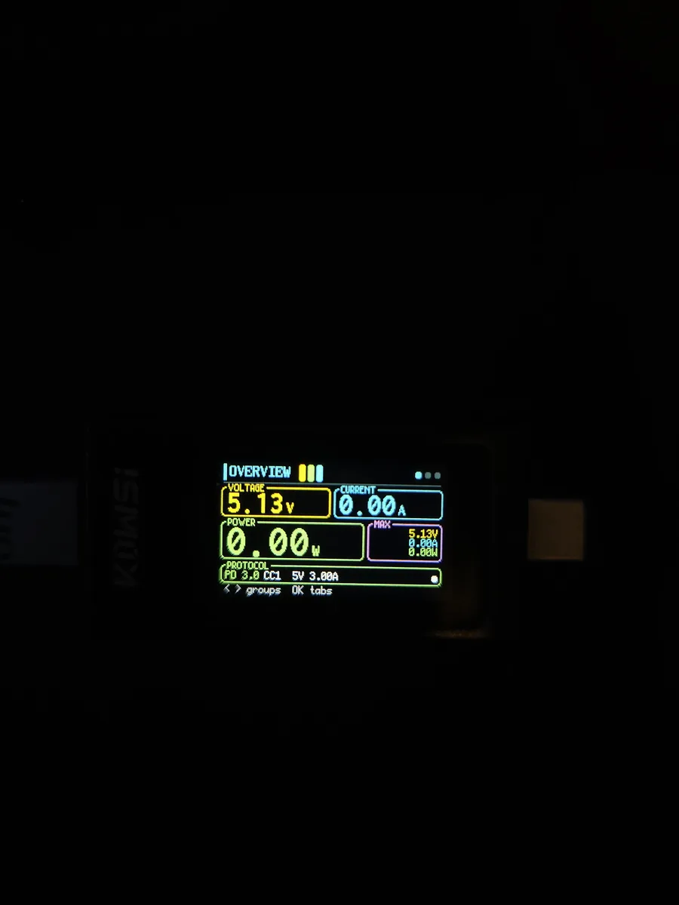
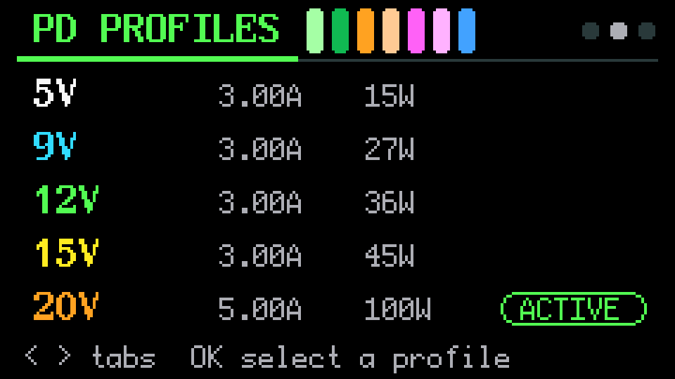
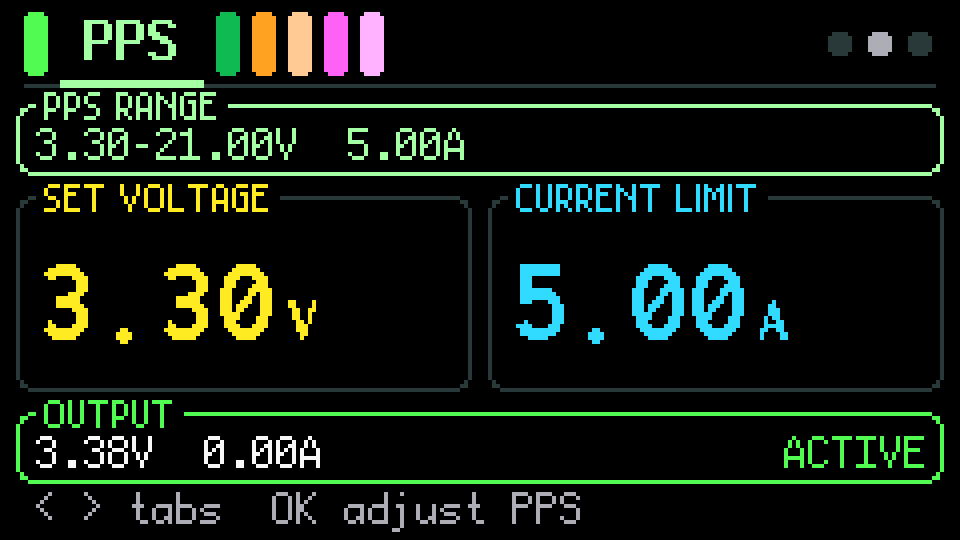
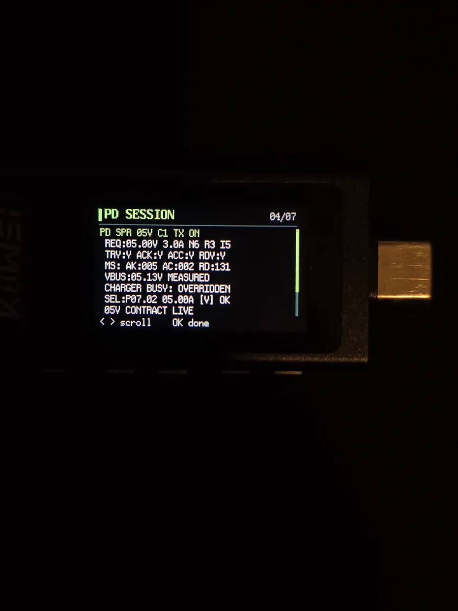
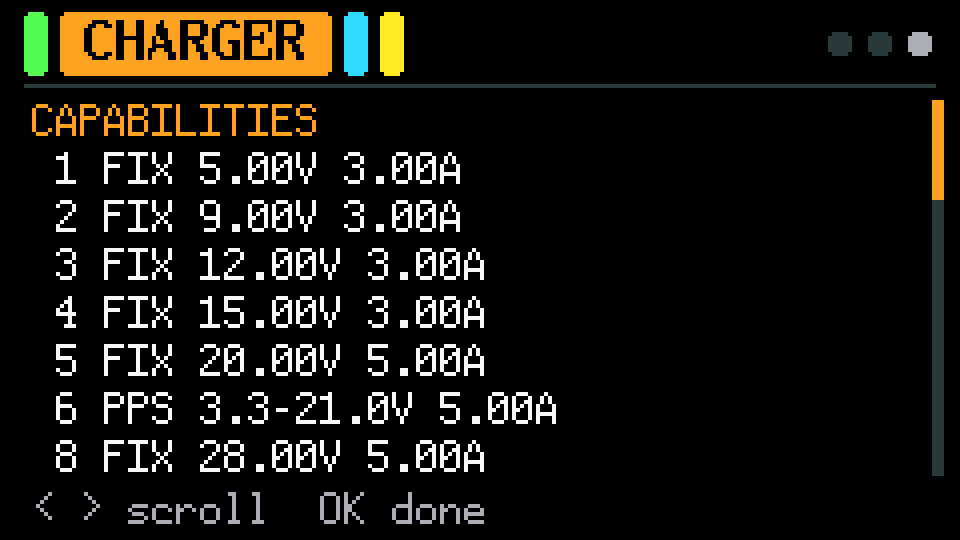
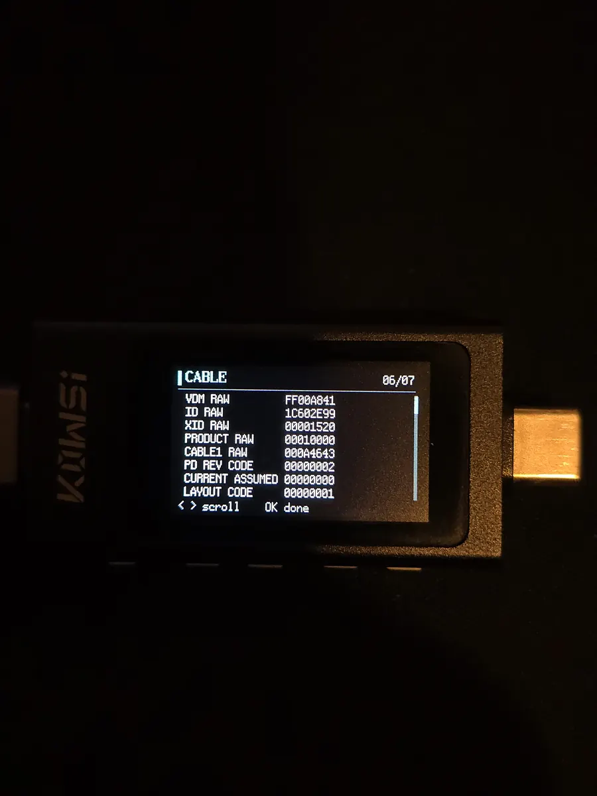
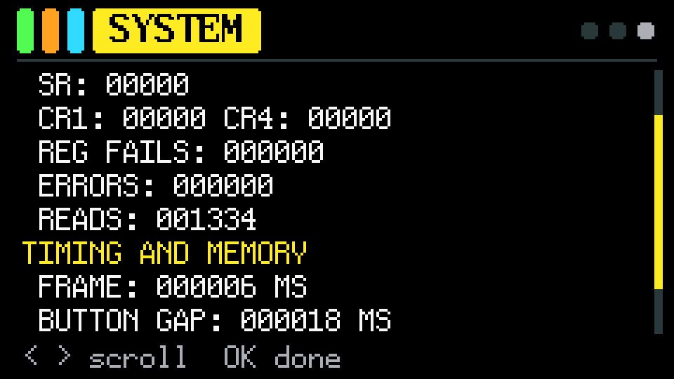
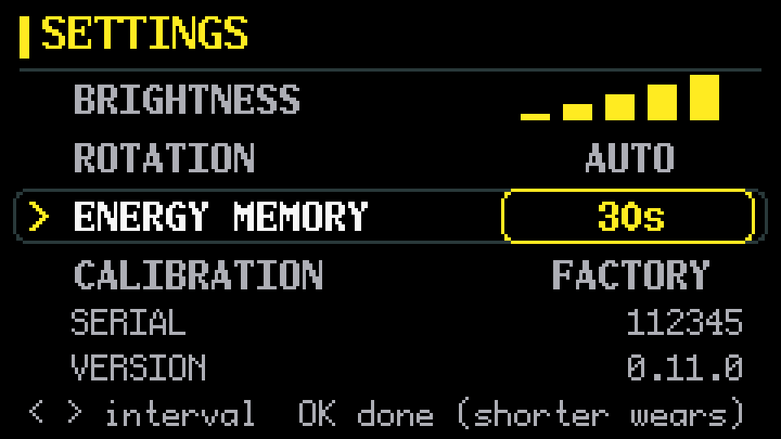
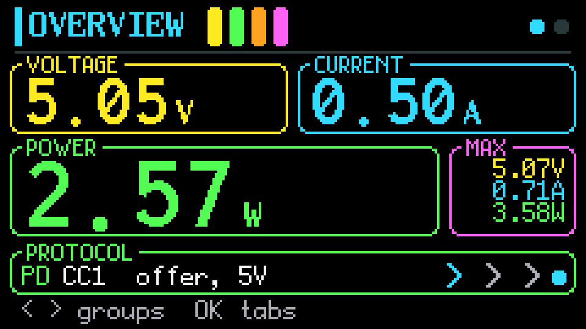
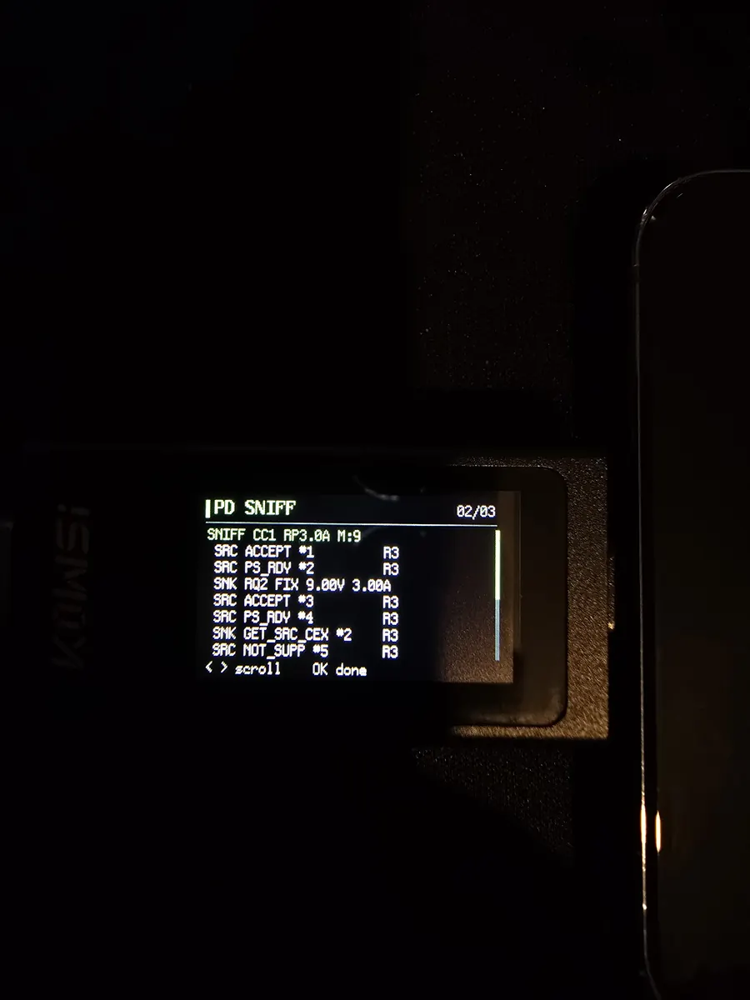

# kws-x1-standalone-rs

Open Rust firmware for the **KOWSI KWS-X1** USB-C power meter. It replaces the
meter's application and keeps the original bootloader, which flashes it over
USB (see [Flashing](#flashing)). The meter is built around an HC32F460 MCU and
a FUSB302B Type-C/PD controller. Its power monitor, tilt sensor and display
controller behave as an INA226, a LIS3DH and an ST7789V, and the firmware
drives them as such; those three parts are inferred, not confirmed (see
[Hardware reference documents](#hardware-reference-documents)). This project
is not affiliated with or endorsed by KOWSI.

> **Disclaimer.** This is unofficial firmware, provided as is, without warranty
> of any kind. Flashing it, and using the meter with it, is entirely at your
> own risk. The author is not responsible for any damage to the meter, to
> chargers, cables or connected devices, or for any other loss. Sink mode can
> put up to the charger's highest voltage on the meter's output.

## Contents

- [Download or build](#download-or-build)
- [Related repositories](#related-repositories)
- [Features](#features)
- [Limitations](#limitations)
- [Using the meter](#using-the-meter)
  - [Buttons](#buttons)
  - [Modes: sink or passthrough](#modes-sink-or-passthrough)
  - [Ways to connect](#ways-to-connect)
  - [Pages](#pages)
  - [What is saved](#what-is-saved)
- [Screens](#screens)
  - [Sink mode](#sink-mode)
  - [Passthrough mode](#passthrough-mode)
- [Full charger offer and 5 A without a cable](#full-charger-offer-and-5-a-without-a-cable)
- [Hand-test checklist](#hand-test-checklist)
- [Safety](#safety)
- [Layout](#layout)
- [Hardware reference documents](#hardware-reference-documents)
- [Build and validation](#build-and-validation)
  - [Package and audit offline](#package-and-audit-offline)
  - [Firmware builds and release downloads](#firmware-builds-and-release-downloads)
  - [Flashing](#flashing)
  - [Going back to stock](#going-back-to-stock)
- [License](#license)

## Download or build

You do not need to compile the firmware yourself. Download `firmware.X1C` and
`SHA256SUMS` from a published **`firmware-v*` release**, and download the flasher
for your OS from a **`flasher-v*` release**, both on
[GitHub Releases](https://github.com/kralonur/kws-x1-standalone-rs/releases).
Verify the checksums and follow [Flashing](#flashing). Downloaded firmware and
flasher binaries need **no Rust or Python installation**.

Prefer to compile it yourself? Follow [Build and validation](#build-and-validation)
and [Package and audit offline](#package-and-audit-offline). If no firmware release
is published yet, the [firmware workflow](https://github.com/kralonur/kws-x1-standalone-rs/actions/workflows/firmware.yml)
provides build artifacts for signed-in GitHub users; these are development builds,
not published releases.

## Related repositories

These repositories form one firmware project. The firmware pins each library
by full Git revision, and every library is usable on its own.

| Repository | Contents |
| ---------- | -------- |
| [kws-x1-standalone-rs](https://github.com/kralonur/kws-x1-standalone-rs) | firmware for a USB-C power meter, built on the libraries below |
| [hc32f460-embassy-rs](https://github.com/kralonur/hc32f460-embassy-rs) | `hc32f460-pac` and `embassy-hc32`: peripheral access crate and Embassy HAL for the HC32F460 MCU |
| [embedded-charging-protocols-rs](https://github.com/kralonur/embedded-charging-protocols-rs) | `pd-protocol`: allocation-free, `no_std`, hardware-independent USB PD sink engine |
| [usbpd](https://github.com/kralonur/usbpd) | fork of [elagil/usbpd](https://github.com/elagil/usbpd): the `usbpd` policy engine and the `usbpd-traits` PHY interface |

This is **kws-x1-standalone-rs**.

### Adapting it to other hardware

- **Another HC32F460 board:** use `hc32f460-embassy-rs` as it is, and take pin
  setup, clocks and the task layout from `firmware/src/main.rs`.
- **Another MCU with a FUSB302:** `fusb302-pd` depends only on
  `embedded-hal-async` I2C, `pd-protocol` and `usbpd-traits`. Implement its
  `Platform` trait (power-on register baseline, measure setting, limits,
  timeouts) and the gated bus for your board.
- **Another PD controller:** implement `usbpd-traits` for it and drive
  `pd-protocol` as `fusb302-pd` does.
- **Board-specific and not portable as is:** the panel setup, the flash
  layout, the bootloader image format and the `firmware-pack` validation policy.

## Features

- Voltage, current and power in either direction, with peaks and a flow
  direction indicator.
- D+, D-, CC1 and CC2 line voltages.
- USB PD sink: fixed profiles up to 20 V and PPS, chosen on the meter.
- Quick Charge trigger (work in progress): 5, 9, 12 or 20 V over D+/D−, or
  Quick Charge 3.0 0.2 V steps from 3.6 V, checked against VBUS, and a probe
  that reports Quick Charge 2.0 or 3.0 and Class A or B. On USB-C the meter
  switches the charger out of PD for it by itself.
- A full charger scan (hold OK on the charger page): Quick Charge, the PD
  offer, the EPR offer and, with the plug in the charger, the 5 A offer, on
  one page.
- Everything the charger says about itself: its full offer (EPR included),
  identity, ratings and status.
- Cable e-marker reading, and a 5 A cable test for the meter's plug.
- Passthrough mode: listens to the PD messages between a charger and a device
  without taking part.
- Brightness and auto-rotation, saved to flash.

## Limitations

What this firmware does **not** do, for now:

- **USB PD and Quick Charge only.** No other fast-charging protocol is
  triggered: no Samsung AFC, Huawei FCP/SCP or anything else on the D+/D-
  lines. Beyond those two the overview names the Type-C current
  advertisement, the fixed D+/D- voltages some ports use to tell their
  current (`DIVIDER`, `1.2V DCP`) and the BC1.2 short once the Quick Charge
  test found it; a BC1.2 port looks like a plain USB port until then.
- **No EPR.** The meter can ask for and list the EPR offer (28 V and up), but
  it never enters EPR mode and cannot request an EPR voltage. Requests stay
  within the standard range: fixed profiles up to 20 V and PPS.
- **No AVS requests.** AVS and EPR AVS ranges are listed when the charger
  offers them, but cannot be requested.
- **Quick Charge partly tested.** Tested on one Quick Charge 3.0 Class A
  charger, on a USB-A port and on USB-C switched out of PD: fixed 9 and
  12 V, the 0.2 V steps and the probe. 20 V and Class B chargers are
  untested. The trigger drives D+/D− only once a Quick Charge screen
  started it, and keeps them driven while other screens show, until `OFF`
  on the QC 2.0 screen, the switch back to PD, a PD contract or a restart.
- **Sink only.** The meter never acts as a source: no power role swap, no
  data role swap, no VCONN swap, no Cable_Reset.
- **Passthrough only listens.** It cannot change or inject anything between
  the charger and the device, and stops listening for good after a Hard Reset,
  a receive overflow or a malformed frame (until the next power-up).
- **Cable reading needs fixed 5 V and the right orientation.** VCONN reaches
  only one CC pin, so a cable on the other side reads `TURN CABLE OVER`.
- **The 5 A cable test is non-standard**, and works only with the meter's plug
  straight in the charger. See
  [Full charger offer and 5 A without a cable](#full-charger-offer-and-5-a-without-a-cable).
- **No energy or charge counting** (no mAh or Wh), no timer, no graphs, no
  recording, and no USB data connection to a computer or app.
- **No calibration setting.** The measurement uses a fixed sensor calibration.
  The line voltages use an internal reference of 1083 mV, the stock
  firmware's value, rather than the reference manual's "about 1.1 V"
  (1100 mV, RM 16.3.2). A multimeter check on one unit matched it (D+ and D−
  within 5 mV from 0.55 to 3.23 V), but the manual gives no tolerance, so
  another unit may read a few percent off. CC1 and CC2 were not checked.
- **The chosen profile is not remembered:** every boot starts at 5 V.
- **About 6000 settings saves** in the device's lifetime (see
  [What is saved](#what-is-saved)).
- **Flashing uses the Rust flasher on Windows, Linux or macOS** (see
  [Flashing](#flashing)). Project `.X1C` images are generated directly from the
  compiled application; no original firmware file is required.
- **Not certified.** Compiling and hand-testing are not USB-IF or safety
  qualification.

## Using the meter

### Buttons

| Button | Short press | Hold |
| ------ | ----------- | ---- |
| Left / Right | previous / next group, or tab once in a group's tabs; on a framed value, change it; while scrolling, scroll | repeats on PPS and QC 3.0 values and while scrolling |
| OK | go into the group's tabs; on a tab, select, confirm, scroll or start (see each page) | 0.5 s: page action (cable query, full charger scan) |
| Back | up one level: cancel the edit or scroll, leave the tabs; from a group, back to the overview; on the overview, open the settings | – |

The pages sit in three groups: **Monitor** (Overview, Lines), **Trigger**
(PD Profiles, PPS, QC 2.0, QC 3.0) and **Info** (PD Session, Charger, Cable,
System). The header shows the group's tabs as a strip, each in its own
colour: the shown tab is named, the others fold to thin bars. A dot per group
sits on the right. The shown tab marks what Left/Right move: a bar beside its
name and lit dots for groups (the hint row reads `< > groups    OK tabs`), an
underline for tabs, and a filled tab once the page itself has them (choosing,
editing or scrolling). A group comes back on the tab it last showed.

Holding **Back** and **OK** while plugging into a computer starts the
bootloader instead (see [Flashing](#flashing)).

### Modes: sink or passthrough

The slider is read once at power-up. To change mode, move it and plug the
meter in again.

- **Sink** (`PC13:0 SINK MODE` on the PD session page). The meter is the PD
  sink: it negotiates with the charger itself, starting at 5 V, and you pick a
  fixed or PPS voltage. **Whatever is plugged into the other side gets that
  voltage**, so only raise it for a device or load that accepts it.
- **Passthrough** (`PC13:1 PASSTHROUGH`). The meter turns its own CC
  pull-downs off and sits between a charger and a device, which negotiate with
  each other as through a plain cable. The meter measures and logs their PD
  messages; it never sends, never acknowledges and never resets. Only the
  overview, lines, PD session, system and settings pages are shown.

### Ways to connect

- **Plug straight into a charger** (sink). The charger shows Rp on both CC
  pins, so the meter knows nothing is in between. The charger caps the offer
  at 3 A because no cable vouches for more; the charger page's full scan ends
  in the [5 A cable test](#full-charger-offer-and-5-a-without-a-cable) to see
  the full offer.
- **Through a cable** (sink). The charger on either side, through a cable. A
  5 A cable answers the charger itself, so the offer is already the full one.
  The cable page can read the cable's e-marker.
- **Between a charger and a device** (passthrough). The overview shows the
  power flowing, and the PD session page lists their messages.
- **A port without PD** (computer USB-A, or Type-C without PD). The meter
  measures at 5 V; the PD session page reports no capabilities, and the
  PD Profiles page shows `NO PD CHARGER`.

Current is shown as a magnitude; chevrons on the overview's bottom row
point the way it flows (they follow the screen rotation).

### Pages

| Page | Shows | Buttons |
| ---- | ----- | ------- |
| **Overview** | voltage, current, power; the highest of each since boot (`MAX`); protocol (`USB`, `TYPE-C`, `PD 2.0`, `PD 3.0`, `PPS`, `QC 2.0`, `QC 3.0`, `DIVIDER`, `1.2V DCP`, `BC1.2`) with the CC pin and contract; flow chevrons; a heartbeat dot | Back: settings |
| **Lines** | D+, D-, CC1 and CC2 voltages | |
| **PD Profiles** | the charger's fixed profiles, `ACTIVE` on the one in force; with PD off for Quick Charge only `QC MODE` | OK, Left/Right to choose, OK requests it, Back cancels; in `QC MODE` OK switches back to PD |
| **PPS** | the charger's PPS ranges, the set voltage and current limit, the live output; `ACTIVE` or `NOT APPLIED`; with PD off for Quick Charge only `QC MODE` | OK, Left/Right voltage (20 mV, 100 mV held), OK, current limit (50 mA, 250 mA held), OK requests; in `QC MODE` OK switches back to PD |
| **QC 2.0** | 5, 9, 12 and 20 V and `OFF`, the voltages the charger ignored greyed out, the status on its row; under a PD contract only `PD MODE` | OK tests the charger, then opens at 5 V with the choice open (under a PD contract it first switches the charger out of PD); Left/Right choose, OK requests and closes the choice, Back closes it; the request stays in force on other screens until `OFF` |
| **QC 3.0** | the step range, the set voltage, VBUS, D+ and D−; under a PD contract only `PD MODE` | OK tests the charger, then starts continuous mode at 5 V (under a PD contract it first switches the charger out of PD); Left/Right move it by 0.2 V (repeats held); OK or Back closes it; the steps stay in force on other screens until `OFF` on QC 2.0 |
| **PD Session** | sink: session state, CC levels and the charger's offer as received. Passthrough: CC pin, Rp level and the latest PD messages | OK to scroll |
| **Charger** | the offer (`*` = needs a 5 A cable), the charger's identity, maker and peak ratings, power status and source info, the Quick Charge detection result | OK to scroll; hold OK: full scan (Quick Charge, PD, EPR, and the 5 A cable test with the plug in the charger) |
| **Cable** | the cable's e-marker: identity, ratings, status and modes | OK to scroll; hold OK at fixed 5 V to read the e-marker |
| **System** | I2C bus state and counters, frame and button timing, stack use, `LAST RESET:` cause | OK to scroll |
| **Settings** | `BRIGHTNESS` (5 levels, 60% at first), `ROTATION` (`AUTO` follows the tilt sensor, `NORMAL`, `FLIPPED`), `RESET MAX` | Left/Right row, OK change it, Left/Right value, OK or Back done |

The selector pages only show the offer until a sink session has one. A
profile is requested only after the final OK; Left/Right alone just preview.

The heartbeat dot blinks while the meter runs. **Red means the sensor bus is
closed**: readings stop (`--.--`), and the System page says why. That happens
after a bus error, or after a failed PD session left the PD controller in an
unknown state. A port without PD does not close it.

### What is saved

Brightness and rotation are saved to flash once you finish changing them, and
come back at the next power-up, as does the mode the meter restarts the
charger into (full scan, cable test, Quick Charge). The chosen profile is not:
every boot starts at 5 V. `MAX` values live until reset or power-off.

Saving appends an 8-byte record to the meter's original settings area and
never erases flash. Each 8 KiB sector holds 1023 records and up to six are
used, about 6000 saves in all; after that, settings keep working until power-off
but are no longer saved. The bootloader and its region are never written.

## Screens

Every screen, group by group in Left/Right order, with each field it can show.
`-` or `--.--` in a field means "not known yet". Hexadecimal values are raw
register or message contents, shown for diagnosis.

### Sink mode

#### 1. Overview



This is the **Overview** screen (tab `OVERVIEW` in Monitor), the one the
meter starts on.

- **`VOLTAGE`**: bus voltage, in volts. `--.--` until the first reading, or
  while the sensor bus is closed.
- **`CURRENT`**: current in amperes, as a magnitude, whichever way it flows.
- **`POWER`**: voltage × current, in watts.
- **`MAX`**: the highest voltage, current and power seen since power-up or
  the last `RESET MAX` in the settings.
- **Protocol badge** (bottom left): the first of these that applies.
  - `QC 2.0` / `QC 3.0`: this meter's Quick Charge request, while the
    charger follows it. Status: the request (`9V`) or the output the steps
    set (`7.40V`).
  - `PD`: the charger sent an offer, no contract known yet.
  - `PD 2.0` / `PD 3.0`: fixed PD contract and its PD revision.
  - `PPS`: a PPS contract.
  - `QC 2.0` / `QC 3.0` again: Quick Charge another device drives, read from
    D+/D-. A raised request counts once the output moved past halfway to
    it; continuous mode shows `continuous`.
  - `TYPE-C`: Type-C current advertisement without PD (1.5 A or 3 A).
  - `DIVIDER`: a port telling its current by fixed D+/D- voltages (TI
    TPS2514 datasheet, section 8.3.3): D+ 2 V and D- 2.7 V for a 5 W adapter
    (`5V 1.00A`), 2.7 V and 2 V for 10 W (`5V 2.00A`), 2.7 V on both for
    12 W (`5V 2.40A`).
  - `1.2V DCP`: 1.2 V on both lines, which some tablet chargers use
    (section 8.3.4); no rating is published.
  - `BC1.2`: a dedicated charging port with D+ shorted to D- (`5V
    shorted`). Only the Quick Charge test can see the short, so this shows
    after it ran.
  - `USB`: plain USB power (Type-C default current, or no Type-C at all).
  - `NONE`: no source identified yet.
- **Status text** next to the badge: the CC pin in use (`CC1` or `CC2`),
  then one of `no source`, `5V default`, `5V 1.50A`, `5V 3.00A`,
  `offer, 5V`, the contract (for example `9V 3.00A`), or the Quick Charge
  and port values above.
- **Chevrons** `< < <` or `> > >`: the direction current flows, drawn above
  a small threshold. They follow the screen rotation.
- **Heartbeat dot** (bottom right): blinks while the meter runs; red when the
  sensor bus is closed (see the System screen).

#### 2. Lines

This is the **Lines** screen (tab `LINES` in Monitor): the voltages on the USB data and
configuration lines, read by the MCU's own ADC against its internal
reference, independently of the bus sensor and the PD controller.

- **`D+`** / **`D-`**: the USB 2.0 data lines, in volts. Chargers that
  identify themselves on these lines (BC 1.2, Apple and similar dividers) show
  their levels here.
- **`CC1`** / **`CC2`**: the Type-C configuration channels, in volts. The pin
  in use carries the Type-C pull-up/pull-down level; a cable's VCONN shows on
  the other one.
- `-.--`: no reading yet, or the last ADC scan failed.
- **`approximate`** (hint row): the internal reference was measured on one
  unit, and another unit's may differ by a few percent (see
  [Limitations](#limitations)).

The lines are sampled only while this screen, the overview or a Quick
Charge screen is shown, or while Quick Charge runs.

#### 3. PD Profiles



This is the **PD Profiles** screen (tab `PD PROFILES` in Trigger): the charger's fixed profiles.

- **Each row**: voltage, the charger's maximum current at it, and that power
  in watts. The voltage is coloured from cool (low) to warm (high).
- **`ACTIVE`**: the profile in force now.
- **Frame**: the profile being previewed while choosing.
- **`NO PD CHARGER` / `plug in a PD source`**: the charger offered no
  fixed profiles.
- **`QC MODE` / `PD is off while Quick Charge runs`**: this boot keeps PD
  silent for Quick Charge, so there is no offer; the PPS screen shows the
  same. OK (`OK switch back to PD`) switches back to PD.
- **Hint row**: `OK select a profile    < > tabs`, then while choosing
  `< > choose  OK request  BACK cancel`. Before the charger's offer arrives it
  reads `waiting for the charger    < > tabs`.

#### 4. PPS



This is the **PPS** screen (tab `PPS` in Trigger): programmable voltage.

- **Range row**: each PPS range the charger offers, for example
  `3.30-21.00V  up to 5.00A`.
- **`SET VOLTAGE`**: the voltage to request, in 20 mV steps (100 mV while
  held). The arrows show it is the value Left/Right change.
- **`CURRENT LIMIT`**: the current limit to request, in 50 mA steps (250 mA
  while held).
- **`OUT`**: the live voltage and current.
- **State**: `ACTIVE` (this setting is the contract in force), `NOT APPLIED`
  (set but not requested yet), or empty.
- **`NO PPS` / `this charger offers no PPS range`**: nothing to set.
- **Hint row**: `OK adjust PPS    < > tabs`, `< > volts    OK next: current`,
  `< > amps    OK request`, or `waiting for the charger    < > tabs`.

#### 5. QC 2.0

This is the **QC 2.0** screen (tab `QC 2.0` in Trigger), laid out as the PD
Profiles screen.

**Under a PD contract** a USB-C charger ignores Quick Charge, so the screen
shows only `PD MODE` / `the charger ignores QC under PD`, and the PD
Profiles and PPS screens stay in use. OK (`OK switch to QC, tests up to
20V`) switches: the meter restarts the charger with a Hard Reset and boots
with PD silent (Rd held, nothing acknowledged), so the charger falls back to
non-PD 5 V and takes Quick Charge. The charger may restart one or two more
times before it settles. The meter comes back on the Quick Charge screen it
left and tests the charger at once. OK on the PD Profiles or PPS screen
switches back the same way, into PD. The meter stops saving the switch once the charger
had 10 s to settle, so the next plug-in starts with PD again.

**The test** (`TESTING THE CHARGER`) runs the first time Quick Charge starts
in a boot, without a PD contract on OK, or straight after the switch out of
PD. It holds D+ at 0.6 V until the charger releases D−, then requests Quick
Charge 3.0 continuous mode and three 200 mV steps up from 5 V, then 5 V
again (a charger ignored fixed requests sent straight from continuous mode),
9, 12 and 20 V, and ends at 5 V. The checked requests all raise the output,
so a slowly falling VBUS cannot hide the steps. **It puts up to 20 V on the
output port**, so disconnect anything that cannot take that first. It ends
in `NO CHARGING PORT` (D+ and D− are not shorted) or `NO QUICK CHARGE` (D−
never went low) when the charger has no Quick Charge.

After the test the choice opens at 5 V: Left/Right choose among the
voltages the charger took, and OK requests one and closes the choice; Back
closes it without a request. OK reopens it at the voltage in force. The
request stays in force while other screens show, so the overview can watch
it. `OFF` releases D+/D−, and the charger returns to plain USB at 5 V.

Quick Charge never confirms a request, so the meter watches VBUS: a request
whose output has not moved halfway after 610 ms (the charger's 60 ms filter
plus PD's 550 ms supply transition limit) shows `IGNORED`.

- **Rows**: 5, 9, 12 and 20 V, then `OFF` (`plain USB`). Before the test
  20 V reads `Class B only`; after it a voltage the charger ignored is greyed
  out with `charger ignored it` (`needs Class B` on 20 V) and cannot be
  chosen. The choice is framed. The charger page lists the test's full
  result.
- **Status pill** on the row it concerns: `WAIT` (handshake), `SETTING`
  (waiting for VBUS), `ACTIVE`, `IGNORED`, `NO DCP` or `NO QC`.

#### 6. QC 3.0

This is the **QC 3.0** screen (tab `QC 3.0` in Trigger), laid out as the PPS
screen. Under a PD contract it shows only `PD MODE`, and switches as the
QC 2.0 screen does. OK runs the same test the first time, then starts Quick
Charge 3.0 continuous mode at 5 V; Left/Right then move the output by 0.2 V
(held, they repeat), from 3.6 V up to 12 V (20 V on a Class B charger), one
step per 100 ms scan. OK or Back stops adjusting; the output stays where
the steps put it while other screens show. OK reopens it there, and `OFF`
on the QC 2.0 screen ends the steps.
A charger that ignored the steps in the test shows `NO QC 3.0`.

- **Step range** (top): what the test found, else
  `3.6-12V by 0.2V  Class A` and `3.6-20V by 0.2V  Class B`.
- **`SET VOLTAGE`**: the output the steps aim for, framed with arrows while
  Left/Right move it.
- **`VBUS`**: the live bus voltage.
- **`D+ … D- …`**: the lines as measured, to check the driven levels.
- **State** (bottom right): `WAIT`, `STEPPING`, `ACTIVE` (the steps reached
  the set voltage), `NO DCP` or `NO QC`.

#### 7. PD Session



This is the **PD Session** screen (tab `PD SESSION` in Info): the meter's own PD negotiation.
It scrolls (OK) through three sections.

**Session section**

- **`PD SPR 05V C1 TX ON`**: the session kind (`SPR` fixed, `PPS`), the target
  voltage, the CC pin, and the transmitter state: `TX ON` (contract live),
  `TX OFF` (finished and verified off) or `TX UNKNOWN`.
- **`REQ:05.00V 3.0A N6 R3 I5`**: the last request: voltage, current,
  `N` how many objects the charger offered, `R` the charger's PD revision
  (2 or 3), `I` the message ID of the request (0–7).
- **`TRY ACK ACC RDY`**: request written, acknowledged with GoodCRC (`G`:
  GoodCRC seen without the send-done flag), `Accept` received, `PS_RDY`
  received. `Y` yes, `-` not yet.
- **`MS: AK AC RD`**: milliseconds from sending the request to its GoodCRC,
  to `Accept`, and to `PS_RDY`.
- **`VBUS:05.13V MEASURED`**: the live bus voltage. Before a live reading the
  row is `V:G--.-- RD--.-- RT--.--`: VBUS before the request, at `PS_RDY`, and
  after the session ended.
- **Row 6**, one of:
  - `ERR:---- A:---- R:----`: the error code (table below), the I2C address
    and the register involved.
  - `CHARGER BUSY: OVERRIDDEN`: the charger kept its "wait" signal on a quiet
    line, and the meter sent anyway (see the safety notes).
  - `CHARGER BLOCKS CHANGES`: the charger's signal did not allow sending.
  - `TX LOST TO CHARGER MSG`: a charger message arrived first, so the meter's
    message was dropped unsent.
  - `CABLE QUERY - 5V ONLY`, or a cable result such as
    `CABLE:P 20V 5A SPD:2` (`P` passive / `A` active, maximum voltage,
    current, `*` = current assumed, `EPR` when the cable is EPR capable,
    `SPD`/`S` speed code).
- **Row 7**, one of:
  - `SEL:P07.02 05.00A [V] OK`: the selection being prepared (`P` for PPS,
    `[V]` or `[I]` for the value being changed).
  - `SEL:09V`: the fixed profile being prepared.
  - `HOLD BACK TO STOP`, `POST S1:---- C3:----` (controller registers after
    the session), `RESTORE NOT VERIFIED`, `VCONN STATE UNVERIFIED`,
    `VALUE:----` (an unexpected register value), or a cable `VID`/`PID`.
- **Last row**, the session state:
  - `05V CONTRACT LIVE` / `PPS07.02V 05.00A LIVE`: a contract is in force.
  - `SPR NEGOTIATING` / `PPS NEGOTIATING`: asking for it.
  - `05V SEEN ROK TX OFF`: the session finished cleanly.
  - `NO CAPS / HALTED` / `NO CAPS RESTORED`: the charger sent no offer
    (a port without PD).
  - `WAIT CC TEST`, `MEAS RX POWER`, `RX LISTEN TX OFF`,
    `CAPS RESTORED TX OFF`: startup steps.
  - `SKIP BUS LATCHED`: the session never started; the bus was closed.
  - `FAIL REG:----`, `SKIP REG:----`, `DIFF REG:----`: stopped on a
    register error, an unexpected start state, or a value that did not read
    back.

**Startup section**

- **`CC1:-- CC2:--`**: both CC pins' status at startup.
- `ONE CC WITH RP`: a normal attach through a cable.
- `BOTH RP: VCONN ON CC1/CC2`, `BOTH RP: TRAFFIC ON CC1/CC2` or
  `BOTH RP: NO SINGLE LINE`: the meter's plug sits in the charger, and how
  it picked the line to talk on.
- `CC1 SOP:--- CABLE:---` and `CC2 …`: messages heard on each pin for the
  charger and for a cable.

**ERR codes** (hexadecimal):

| Code | Meaning |
| ---- | ------- |
| `0001` | stopped on an I2C error |
| `0002` | wrong CC orientation or input voltage; not started |
| `0003` | receive buffer not empty at a boundary |
| `0004` | Hard Reset received |
| `0005` | PD controller fault |
| `0006` | unexpected transmission |
| `0007` | receive buffer overflow |
| `0008` | malformed message |
| `0009` | unexpected acknowledgement |
| `000A` | request refused by the meter's checks |
| `000B` | message queue full |
| `000C` | polling budget used up |
| `000D` | transmit timeout (row 6 then shows `TO S1 IA N H`) |
| `000E` | could not complete the session |
| `000F` | protocol error from the charger |
| `0010` | PPS keep-alive deadline missed |
| `0011` | Hard Reset needed |
| `0012` | message not acknowledged |
| `0013` | VBUS did not return after a Hard Reset |
| `0014` | VBUS problem during a BIST test |
| `0020` | session stopped |
| `0021` | unsupported controller |
| `0022` | charger offer failed the safety checks |
| `0023` | charger protocol error |
| `0024` | received message discarded |
| `0025` | Hard Reset received |
| `0026` | transmit failed |
| `0027` | request declined |
| `0028` | no offer from the charger (port without PD) |
| `0029` | sending blocked |
| `002A` | PD engine error |
| `002B` | session ended without a contract |
| `002C` | Hard Reset sent |

#### 8. Charger



This is the **Charger** screen (tab `CHARGER` in Info): what the charger says about
itself, then what Quick Charge detection found. The PD parts are the
charger's claims, not measurements, then the Quick Charge result. It
scrolls (OK) through the parts; a long offer takes two screens.

**`CAPABILITIES`**

- **One row per offered object**, numbered by its position:
  - `FIX 9.00V 3.00A`: a fixed voltage.
  - `PPS 3.3-21.0V 5.00A`: a PPS range.
  - `AVS …A/…A`, `EAVS 15.0-48.0V 140W`: adjustable voltage (AVS) ranges,
    shown when the charger offers them. The meter cannot request AVS; it
    requests only fixed and PPS objects.
  - `RAW xxxxxxxx`: an object type the meter does not decode.
- **`*`** after a row: offered at that current only with a 5 A cable. Then
  the note `* ONLY WITH 5A CABLE`.
- **Notes**:
  - `HOLD OK: FULL SCAN` / `QC AND EPR; RESTARTS` (`QC, EPR, 5A; RESTARTS`
    with the plug in the charger): hold OK for the full scan.
  - After the scan, the EPR (28 V and up) request: `ASKING CHARGER`,
    `NO ANSWER, HOLD OK AGAIN`, `LINE BUSY, HOLD OK AGAIN`, or in the 5 A
    cable test `HOLD OK FOR ALL`.
  - `BACK ENDS 5A CABLE TEST`: the test is running. The heading then also
    names the reset cause (`POWER` is expected).
  - `5A TEST DID NOT START` / `HOLD OK TO TRY AGAIN`.
  - `NO PD SESSION`, `NO OFFER YET`.

**`QUICK CHARGE 2.0`** and **`QUICK CHARGE 3.0`**

Quick Charge reports nothing itself, so these show the result of the full
scan or the last Quick Charge test, measured on VBUS:

- **2.0**: the class (`CLASS A, UP TO 12V` or `CLASS B, UP TO 20V`), then
  `YES` or `NO` for each fixed voltage, `5V` to `20V`. `NOT SUPPORTED`
  when the charger took no 9 V.
- **3.0**: `SUPPORTED` with `RANGE 3.6-12V` (up to 20 V for Class B) and
  `STEP 0.2V`, or `NOT SUPPORTED` / `NO 0.2V STEPS`.

A failed handshake shows one `QUICK CHARGE` section with `NOT A CHARGING
PORT` or `NO QUICK CHARGE`. Before any result it shows `NOT SCANNED YET`
with `HOLD OK: FULL SCAN`, or without a PD contract `NOT TESTED YET` with
`HOLD OK: TEST QC`, which runs the test on the QC 2.0 screen.

**`IDENTITY`**

- `REV:3.1 V1.8`: the charger's PD revision and version.
- `EXT CAPS:` the outcome of asking for its extended capabilities.
- `VID:---- PID:----`: USB vendor and product ID.
- `XID:-------- FW:-- HW:--`: certification ID, firmware and hardware version.
- `PDP SPR:---W EPR:---W`: rated power, standard and extended range.
- `HOLD:---MS LOAD:---`: hold-up time in ms and load step rate.
- `COMPL:` the safety standards it claims: `LPS`, `PS1`, `PS2` or `NONE`.

**`PEAKS AND MAKER`**

- `P1`–`P3 OVL:--- MS:---- D:--`: peak current capability: overload %,
  period in ms, duty cycle %; `*` = VBUS may droop.
- `TOUCH:` `LOW`, `GND`, `PE`, and the touch temperature class `T:TS1`,
  `T:TS2` or `T:60950`.
- `IN:` power sources: `EXT`, `UNC`, `BAT` or `NONE`; `BATT:-/-` fixed
  batteries and hot-swap slots.
- `MFR VID:---- PID:----` and the maker's name string.

**`POWER STATUS`**

- `SRC INFO:` then `GUARANTEED` or `MANAGED` with `MAX:---W`.
- `NOW:---W REPORTED:---W`: present and reported power.
- `GUAR:---W MAX2:---W DPS-`: second port's guaranteed and maximum power,
  and whether it is a dual-power source.
- `STATUS:` then `T:` internal temperature (`N/A`, `<2C`, or `°C`) and `N:`
  how many status answers so far.
- `IN:` `DC`, `AC` or `INT`, then any active protections: `OCP`, `OTP`,
  `OVP`, `CL`.
- `TEMP:` `NORMAL`, `WARNING`, `OVERTEMP` or `N/A`; `LIM:CPXET` power
  limited by Cable, other Ports, eXternal power, Events, Temperature.

**Answer words** used in these sections: `OK`, `WAITING`, `NOT SUPPORTED`,
`NO REPLY`, `BLOCKED`, `RESET`, `PD2 N/A` (not available under PD 2.0).

**Full scan.** Hold OK on this screen (`HOLD OK: FULL SCAN`). A charger
ignores Quick Charge under a PD contract, so the meter:

1. Restarts the charger with a Hard Reset into a boot with PD silent, and
   runs the Quick Charge test on the QC 2.0 screen (it may restart once or
   twice more first; it carries on). Back abandons the scan.
2. Saves the result, restarts the charger into PD, asks for the EPR offer by
   itself, and opens this screen with everything: the offer, the EPR offer,
   the Quick Charge sections and the charger's answers. With the plug in the
   charger that boot is the
   [5 A cable test](#full-charger-offer-and-5-a-without-a-cable).

The output goes up to 20 V during the scan.

#### 9. Cable



This is the **Cable** screen (tab `CABLE` in Info): the cable's e-marker. Hold OK at
fixed 5 V to read it. It scrolls (OK) through several sections.

**Before or instead of a reading**

- `HOLD OK AT FIXED 5V`, `DISCOVERY IN PROGRESS`, `NO DISCOVERY YET`,
  `PD HALTED SEE PD PAGE`, `NO VALID IDENTITY`.
- `METER PLUG IN CHARGER:` then `ACTS AS 5A CABLE` (in the test) or
  `NOT ACTING AS 5A CABLE` / `5A TEST: CHARGER PAGE`.
- Failures: `CABLE ID NAK`, `CABLE ID BUSY NO RETRY`, `CABLE: CHARGER BUSY`,
  `CABLE ON CC2: NOT ASKED` / `TURN CABLE OVER`, `CABLE NO GOODCRC` /
  `NO E-MARKER OR NO VCONN`, `CABLE RESET NO ACCEPT`, `CABLE NO ID RESPONSE`.

**`E-MARKER DETAILS`**, one field per row, value in hexadecimal:

- Raw words: `VDM RAW`, `ID RAW`, `XID RAW`, `PRODUCT RAW`, `CABLE1 RAW`,
  `CABLE2 RAW`, `EXTRA RAW`.
- Decoded: `PD REV CODE`, `CURRENT ASSUMED`, `LAYOUT CODE`, `SVDM MAJOR`,
  `SVDM MINOR`, `USB HOST`, `USB DEVICE`, `PRODUCT TYPE`, `MODAL`,
  `ID CONNECTOR RAW`, `VID`, `XID`, `PID`, `BCD DEVICE`, `HW VERSION`,
  `FW VERSION`.
- PD 3 cables: `VDO VERSION`, `PLUG CODE`, `EPR BIT`, `LATENCY CODE`,
  `TERMINATION`, `VOLTAGE CODE`, `CURRENT CODE`, `SPEED CODE`.
- Active cables also: `SBU UNSUPPORTED`, `SBU ACTIVE`, `VBUS THROUGH`,
  `SOP2 PRESENT`, `MAX TEMP C`, `SHUTDOWN TEMP C`, `U3 CLD POWER CODE`,
  `U3 VIA U3S`, `OPTICAL`, `RETIMER`, `USB4 UNSUPPORTED`, `USB2 HUB HOPS`,
  `USB2 UNSUPPORTED`, `USB3 UNSUPPORTED`, `TWO LANES`, `OPTICALLY ISOLATED`,
  `ASYMMETRIC USB4`, `GEN2 OR HIGHER`.
- PD 2 cables: `PLUG CODE`, `PLUG RECEPTACLE` / `B17 RAW`, `LATENCY CODE`,
  `TERMINATION`, `SSTX1 RAW`, `SSTX2 RAW`, `SSRX1 RAW`, `SSRX2 RAW`,
  `CURRENT CODE`, `VBUS THROUGH`, `B3 RAW` / `SOP2 PRESENT`, `SPEED CODE`.

**`LAST SVID REPLY`**: the cable's list of supported SVIDs (`VDO:nn` words).
**`SVID:xxxx MODES SORTED`**: the modes of each SVID, or `SVID SET
REFRESHING`, `LIST NOT COMPLETE`, `READ IN PROGRESS`, `READ NEEDS SAFE
FIXED5V`.
**`MANUFACTURER INFO`** (`VID`/`PID`), **`ACTIVE CABLE STATUS`** and
**`SOP2 CABLE STATUS`** (`T:` temperature or `N/A`/`LOW`, `SHUTDOWN:0/1`,
`SYNC:`, `NO SOP2 ADVERTISED`, `LAYOUT/PRESENCE UNKNOWN`, `PD2 NO
GET_STATUS`, `SECOND PLUG NO DATA`).
**Status words**: `NOT QUERIED`, `ACK`, `NAK`, `BUSY NO RETRY`,
`TIMEOUT NO RETRY`, `LIST INCOMPLETE`, `NOT SUPPORTED`.

#### 10. System



This is the **System** screen (tab `SYSTEM` in Info): the meter's own health.

**Sensor bus**

- **`I2C FAULT  OK`**: the bus is open. `I2C FAULT  BUS!`: closed after a
  failed transfer. `BUS LATCHED  NO I2C ERR`: closed for safety with no
  transfer error (a PD session left the controller unverified, or the bus
  never started).
- **`STEP`**: which step of a transfer timed out: 0 none, 1 bus free,
  2 start, 3 transmit buffer, 4 byte sent, 5 stop, 6 repeated start,
  7 buffer before the read address, 8 receive mode, 9 first byte, 10 second
  byte.
- **`SR`**, **`CR1`**, **`CR4`**: the I2C status and control registers at the
  last failure.
- **`REG FAILS`**: interrupt routing failures at startup; should be 0.
- **`ERRORS`**: failed transfers.
- **`READS`**: completed meter readings.

**`TIMING AND MEMORY`**

- **`FRAME`**: how long the last screen refresh took, in ms.
- **`BUTTON GAP`**: the longest gap between two button checks since boot, in
  ms (normally 10).
- **`STACK`**: the most stack used since boot / the stack size, in bytes.
- **`LAST RESET`**: the reset cause flags in hexadecimal, then their names:
  `POWER`, `PIN`, `BROWNOUT`, `PVD1`, `PVD2`, `WDT`, `SWDT`, `PDOWN`, `SOFT`,
  `MPU`, `RAMPAR`, `RAMECC`, `CLOCK`, `XTAL`, `MULTI`. After a plain plug-in
  only `POWER` is set.

#### Settings



This is the **Settings** screen (Back on the overview).

- **`BRIGHTNESS`**: five bars, 20%, 40%, 60%, 80% and 95%. Saved.
- **`ROTATION`**: `AUTO` (follows the tilt sensor), `NORMAL` or `FLIPPED`.
  Saved.
- **`RESET MAX`**: OK clears the overview's `MAX` values.
- **Hint row**: `< > choose  OK change  BACK exit`, then
  `< > dimmer/brighter    OK done` or `< > auto/normal/flipped  OK done`.

### Passthrough mode

Passthrough shows four screens: Overview and Lines in Monitor, PD Sniff and
System in Info; the Trigger group is left out. The Overview, Lines and System
screens read as in sink mode.

#### 1. Overview in passthrough



This is the **Overview** screen while a charger and a phone negotiate through
the meter. The badge and status (`PD 3.0`, `CC1 9V 3.00A`) come from the
messages the meter overheard, and the chevrons show which way power flows.

#### 2. PD Sniff



This is the **PD Sniff** screen (tab `PD SNIFF` in Info): the PD messages between the
charger and the device, oldest first. The meter only listens.

- **`SNIFF CC1 RP3.0A M:9`**: the CC pin carrying PD, the charger's Type-C
  current advertisement (`RPDEF`, `RP1.5A`, `RP3.0A`), and `M` the number of
  messages seen (GoodCRC acknowledgements are not counted).
- **`SNIFF STOP …`**: listening stopped: `CC ?`, `GUARD`, `VERIFY`, `DRIFT`
  (register checks), `FLUSH ST`, `BUS`, `HARD RESET`, `RX OVERFLOW`,
  `BAD FRAME`, `TX FLAG`, `PHY FAULT` or `HALTED`.
- **Each message row**:
  - `SRC` / `SNK`: who sent it (as the message claims).
  - The message name: `ACCEPT`, `REJECT`, `PS_RDY`, `WAIT`, `SOFT_RESET`,
    `NOT_SUPP`, `GET_SRC_CAP`, `GET_SRC_CEX`, `GET_STATUS`, `GET_REV`,
    `SRC_CAP`, `REQUEST`, `ALERT`, `VDM`, `STATUS`, `EPR_SRC_CAP`, and the
    rest of the PD message set. Unknown types show as `CTRL`, `DATA` or
    `EXT` with their type number.
  - `#n`: message ID for control messages; `Nn`: object count for
    capabilities; `xxxx:xx` SVID and command for VDMs; `nB` and `Cn`/`RQCn`
    size and chunk for extended messages.
  - `RQ2 FIX 9.00V 3.00A`: a request for object 2 (`EQ` for EPR requests),
    fixed or PPS, voltage and current.
  - `R2` / `R3`: the PD revision in the message.
- **`CHARGER OFFER  GCRC:n`** (next section): the charger's last offer, one
  object per row as on the Charger screen, and the GoodCRC count.
- Before any message: `PASSTHROUGH RX ONLY`, `NO TX NO GOODCRC`, and
  `STARTING` or `WAITING FOR PD TRAFFIC`.

## Full charger offer and 5 A without a cable

USB PD chargers only offer more than 3 A (for example 20 V 5 A, or PPS 5 A)
when they know the cable can carry it. A 5 A cable proves that with an
electronic marker ("e-marker"): a small chip in the plug that answers the
charger's SOP' `Discover Identity` question with a Passive Cable VDO saying
"5 A". Without that answer the charger caps every object at 3 A.

When the meter's own plug sits directly in the charger, there is no cable:
the meter's plug *is* the cable. For a capability test the meter can answer
that question itself, as the source firmware did. It does so only in the
**5 A cable test**. Otherwise it stays silent, and the charger offers what it
would through any 3 A cable.

**Running the test.** It is the last part of the full scan: on the charger
page, hold OK (`HOLD OK: FULL SCAN`). The charger asks the cable question only
right after plug-in, so the meter restarts the charger to be asked again:

1. After the scan's Quick Charge part, it saves a one-boot "cable test" mode
   with the settings.
2. It sends a Hard Reset. The charger removes VBUS and VCONN, which powers the
   meter off, then turns them back on and starts over as at plug-in.
3. That boot reads and clears the mode. It opens the charger page, answers the
   cable question as a 5 A cable, and asks for the EPR list by itself.

During the test the meter stays on the charger page at the boot's 5 V: it
only scrolls, asks for the EPR list again (hold OK) or ends the test. Other
pages and profile selection are locked out, in the buttons and again in the PD
session.

During the test the `CAPABILITIES` heading also names how that boot started:
`POWER` alone is the expected power cycle. The test runs only on a boot that
follows a power-up, after its one-boot mode was cleared and read back. A boot
after any reset without power loss (for example one during that clear), or a
failed clear, runs normally on the charger page with `5A TEST DID NOT START`;
the mode is then cleared once the meter is up, and holding OK tries again. So
no reset can repeat the test.

**Back** on the charger page during the test restarts the same way into normal
mode. A meter powered another way through the VBUS drop sees VBUS go and come
back, then resets itself.

Releasing Rd instead, so the charger would see an unplug, does not work: the
charger kept VBUS on, and the meter's next boot got no Source_Capabilities
(`ERR:0028`).

Answering is a deliberate stretch of USB PD: only a real, certified cable's
e-marker is meant to answer SOP'. It also tells the charger that the whole path
can carry 5 A, so a load on the meter's output must then be connected with a
5 A cable.

In the test:

1. **Spot the setup at startup.** A charger drives Rp on both CC pins of its
   receptacle, so the meter sees Rp on both. The charger also powers VCONN on
   the plug's second CC pin, the pin a cable's e-marker would use. The CC check
   compares each pin against a 2.1 V threshold, which is above any valid
   Rd-line level (max 2.04 V). One pin above it is the VCONN pin, so the charger
   talks on the other pin.
2. **Start immediately.** The charger asks the cable question only in the first
   moments after attach and gives up after about 20 unanswered tries. So the
   meter picks the talking pin from the voltages instead of listening for
   traffic first, and starts its PD session at once with SOP' reception on.
3. **Answer as a 5 A passive cable.** A SOP' `Discover Identity` from the
   charger is acknowledged and answered with an ACK carrying the Cable Plug
   flag, an ID Header (passive cable, Type-C plug), and a Passive Cable VDO for
   5 A, 20 V, USB 2.0 (`firmware/src/pd_spr_phy.rs`, `EMARKER`). Other SOP'
   messages get their GoodCRC and no reply, like a cable without modes.
4. **The charger raises its offer.** From then on Source_Capabilities show the
   5 A objects, as with a real 5 A cable.

**EPR objects.** The 28 V and higher objects are sent only on request. Hold OK
on the charger page and the meter sends `EPR_Get_Source_Cap`, then collects the
chunked `EPR_Source_Capabilities` answer. The page then lists every object the
charger has. The request is informational only: no EPR mode is entered and no
EPR object is requested. If the charger keeps the line busy, the request is
retried a bounded number of times, and the page then says to hold OK again.

**Sending while the plug sits in the charger.** In this setup the talking pin can
show the plain default Rp level instead of the PD 3 "you may send" level. A
quiet default level for 100 ms is treated like the already-approved stale
"wait" level, so the meter can still start its own requests.

The meter itself is rated 4-30 V, 0-12 A, so 5 A through its plug is within
its rating. This is only done with the meter's plug in the charger and during
the test; with a real cable in between, the cable answers for itself. Without
the test, the cable page reads `NOT ACTING AS 5A CABLE`, and the charger page
marks objects that are only offered at 5 A with `*`.

## Hand-test checklist

There is no hardware test rig, so run this list on the meter after every flash
that touches the behaviour in a step. Leave the output unloaded, or use a load
rated for the selected voltage. Any `ERR:` code, unexpected restart or frozen
screen fails the run: note the code and the System page `LAST RESET:` first.

Before flashing:

1. The [build](#build-and-validation) checks and host tests pass, the image passes the offline
   audit, and `flasher --dry-run` accepts it.

Passthrough (slider at passthrough, then power up):

2. The overview measures. Nothing negotiates, and the charger powers the far
   side as if the meter were a plain cable.

Sink (slider at sink, then power up from a PD charger through a cable):

3. The overview shows voltage, current and the flow chevrons. Tilt the meter:
   with rotation on auto, the screen follows. OK, Right: the lines page updates
   D+, D-, CC1 and CC2, and the CC pin the overview names reads above 0 V.
   Compare the values with a multimeter where the lines are reachable.
4. Settings (Back on the overview): change brightness and rotation, then
   unplug and plug in again. Both are kept. Reset peaks clears them.
5. PD Profiles page (Trigger group, OK to reach its tabs): step through the
   profiles, confirm one, check the overview voltage, then go back to 5 V.
6. PPS page (PPS charger): step voltage and current, confirm, check the
   overview.
7. Charger page (Info group): it lists the offer. With an EPR charger, hold OK: the 28 V and
   higher objects appear. With a 3 A cable, objects that need 5 A carry `*`.
8. Cable page with an e-marked cable, from fixed 5 V: it shows the marker's
   details.
9. System page: `LAST RESET:` reads `POWER` after a plain plug-in, and the I2C
   fault counters stay at zero.
10. Unplug and plug the charger back in mid-session: the meter boots and
    negotiates again.
11. A port without PD (computer USB-A, or Type-C without PD): the PD page
    reports no capabilities, the overview keeps measuring with its heartbeat
    dot not red, and the System page reads `I2C FAULT  OK`.

5 A cable test (meter plugged straight into the charger, no cable):

12. On the charger page, hold OK. The screen blacks out once, then the charger
    page shows `POWER` in its heading and lists the 5 A objects.
13. Left, Right and the other tabs and groups do nothing. Hold OK: the EPR list is asked
    for again.
14. Back: one more restart, into normal mode. The 5 A objects carry `*` again,
    and the cable page reads `NOT ACTING AS 5A CABLE`.
15. If a test boot ever shows `5A TEST DID NOT START`, record its heading. Then
    holding OK must try once more and not loop.

## Safety

See [the safety contract](docs/SAFETY.md) before changing PD handling or preparing
an image. Compilation is not hardware or USB-IF qualification. The firmware runs
on the meter and its features were checked by hand there, but there is no
systematic hardware regression suite. Packaging must independently
preserve the bootloader and settings regions; passing the offline
audit and dry-run still does not authorize flashing. Runtime architecture cleanup
and hardware qualification remain separate from this port.

## Layout

Rust 2024 firmware using Embassy on HC32. The application and FUSB302 adapter
are local; the HAL, PAC, portable PD policy and PD engine are pinned Git
dependencies. No external source snapshots are maintained here.

The native PHY and policy engine use the same pinned Git `usbpd-traits`; no
crates.io patch is needed. `fusb302-pd` has no controller driver dependency: its
register map, bit fields and FIFO tokens come directly from the data sheet below.

- `firmware/`: startup, peripheral ownership, async tasks, meter/UI and PD routing.
- `firmware-core/`: board limits, buttons and panel geometry.
- `firmware-image/`: shared container layout, builder and checksum validation.
- `firmware-pack/`: host-only Rust container generation and application auditing.
- `flasher/`: host-only Rust USB flashing.
- `fusb302-pd/`: checked controller configuration, FIFO transport, gated sink
  sessions and receive-only passthrough.

The firmware starts at the existing bootloader's application entry. It does not
use the original graphics bank and may grow into it; "standalone" does not mean
a replacement bootloader or a self-contained whole-flash image. Legacy hybrid overlays, offline firmware
experiments and historical test suites are not included. `firmware-pack` reuses
the shared `firmware-image` builder for standalone generation and offline auditing;
`flasher` provides guarded USB flashing without imposing the project's vector
policy on stock/custom firmware.

## Hardware reference documents

Document names, revisions and links are defined here only. Source comments use
the alias followed by a table or section, for example `DS Table 38`. Do not
repeat document URLs, revision numbers or alias definitions in source files.
Table numbers belong to the cited revision; check them before moving to another.

Only two parts are confirmed: the HC32F460, and the FUSB302B, whose device ID
is checked at every boot. The power monitor, tilt sensor and display
controller are inferred from their bus addresses, their register behaviour
and the original firmware's startup commands. No chip marking or ID register
has confirmed them, so the **INA**, **LIS** and **ST** documents describe the
parts they behave as.

- **Armv7-M ARM** — **ARMv7-M Architecture Reference Manual**,
  [ARM DDI 0403E.b](https://developer.arm.com/documentation/ddi0403/latest):
  BL and BLX (register) encodings (A7.7.18, A7.7.19) and exception entry
  stacking (B1.5.6).
- **DS** — **FUSB302B Programmable USB Type-C Controller w/PD data sheet**,
  [onsemi Rev. 5, August 2021](https://www.onsemi.com/download/data-sheet/pdf/fusb302b-d.pdf)
  (publication order number `FUSB302B/D`): I2C address (Table 15), register
  map (Table 16), per-register fields (Tables 17–39), FIFO access (Table 40),
  TX/RX FIFO tokens (Tables 41–42) and I2C timing (Table 14).
- **INA** — **INA226 36V, 16-Bit, Ultra-Precise I2C Output Current, Voltage,
  and Power Monitor With Alert** data sheet,
  [TI SBOS547C, revised August 2026](https://www.ti.com/lit/ds/symlink/ina226.pdf):
  target addresses (Table 6-2), register map (Table 7-1), configuration fields
  (Tables 7-2 to 7-6), Bus Voltage LSB (Table 7-8), Mask/Enable (Table 7-12)
  and calibration (Equation 1).
- **LIS** — **LIS3DH MEMS digital output motion sensor** data sheet,
  [ST DocID17530 Rev 2, December 2016](https://www.st.com/resource/en/datasheet/lis3dh.pdf):
  I2C address (Table 16), register map (Table 21), CTRL_REG1/3/4 (Tables 29–31,
  35–38), INT1_CFG and interrupt modes (Tables 53–55), INT1_THS (Tables 58–59)
  and I2C timing (Table 8).
- **RM**, **Errata** and **HC32 Datasheet** — the HC32F460 reference manual,
  errata sheet and data sheet, as defined in the pinned
  [HAL repository](https://github.com/kralonur/hc32f460-embassy-rs)'s README.
  The data sheet's pin function tables are Table 2-1 (Func0–15 and each pin's
  Func32–63 group) and Table 2-2 (Func32–63 by group).
- **ST** — **Sitronix ST7789V 240RGB x 320 dot 262K Color with Frame Memory
  Single-Chip TFT Controller/Driver** data sheet, Version 1.3 (2014/03):
  source outputs (section 2), system commands (section 9.1: SLPOUT 9.1.12,
  CASET 9.1.20, RASET 9.1.21, MADCTL 9.1.28) and panel commands (section 9.2).
- **TPS2514** — Texas Instruments **TPS2513, TPS2513A, TPS2514, TPS2514A USB
  Dedicated Charging Port Controller** data sheet, SLVSBY8D (June 2020), from
  [ti.com](https://www.ti.com/lit/ds/symlink/tps2514.pdf): divider and 1.2 V
  modes (sections 8.3.3 and 8.3.4) and their output voltages (section 7.5).
- **USB PD** — **Universal Serial Bus Power Delivery Specification**, Release 3.2,
  Version 1.2 (August 19, 2026), from the
  [USB-IF document library](https://www.usb.org/document-library/usb-power-delivery).
  Bare `section`/`Table` numbers in PD code refer to this revision; it is a
  reorganization of Version 1.1, so V1.1 numbers must not be reused. PD 2.0
  behaviour cites Release 2.0, Version 1.3 (January 12, 2017) as `PD2 V1.3`.

## Build and validation

Use the current stable Rust toolchain:

```sh
rustup target add thumbv7em-none-eabihf
cargo fw --locked
```

The ELF is `target/thumbv7em-none-eabihf/release/firmware`.

```sh
cargo fmt --all -- --check
cargo check --locked --workspace --exclude firmware
cargo check --locked -p firmware --target thumbv7em-none-eabihf
cargo clippy --locked --workspace --exclude firmware --all-targets -- -D warnings
cargo clippy --locked -p firmware --all-features --target thumbv7em-none-eabihf -- -D warnings
cargo test --locked -p fusb302-pd --lib
cargo test --locked -p firmware-core --lib
cargo test --locked -p firmware-pack --test cli
```

The libraries set `test = false` so `--all-targets` builds for the embedded
target never compile host-only tests; run their unit tests on the host with an
explicit `--lib`, as above.

The CLI regressions exercise standalone container generation and audit refusal paths
with synthetic files. They never discover or open a device.

Diagnostic features are opt-in: `pd-hold-diagnostic` holds Rd without a sink
session; `pd-boot-diagnostic` boots on the PD page and records progress;
`cable-log` records cable inspection/fatal events; `i2c-rx-poll-diagnostic`
enables the HAL's receive diagnostic. Flash logging writes persistent storage,
so diagnostic images are not interchangeable with the normal build.

### Package and audit offline

Uses current stable Rust and its bundled LLVM tools. The `firmware-pack` CLI
generates `.X1C` directly from the built application, zero fill and a fixed
16-byte footer descriptor. No baseline image, template file or download is
required. `pack` refuses existing outputs rather than overwriting them;
`audit` checks an exact hash-confirmed image against the built application.
Both emit JSON reports to stdout and never access USB hardware.

```sh
rustup component add llvm-tools
mkdir -p build
HOST=$(rustc -vV | awk '/^host:/ {print $2}')
"$(rustc --print sysroot)/lib/rustlib/$HOST/bin/llvm-objcopy" \
  -O binary target/thumbv7em-none-eabihf/release/firmware build/firmware.bin
cargo run --release -p firmware-pack --locked -- pack \
  --app build/firmware.bin --out build/firmware.X1C > build/package.json
IMAGE_SHA256=$(sha256sum build/firmware.X1C | cut -d ' ' -f 1)
cargo run --release -p firmware-pack --locked -- audit \
  --image build/firmware.X1C --confirm-sha256 "$IMAGE_SHA256" \
  --app build/firmware.bin > build/audit.json
cargo run --release -p flasher --locked -- \
  --dry-run --image build/firmware.X1C --confirm-sha256 "$IMAGE_SHA256"
```

The container uses the layout implemented by `firmware-image::build_container`:
the two-byte prefix, application bytes, zero fill, a 16-byte descriptor at
payload offset `0x333fc`, a big-endian additive checksum at `0x3340c`, the
`0x80` marker and 559 zero trailer bytes. The complete file is 210498 bytes
(210496-byte payload, 3289 chunks, 26 sectors). The audit verifies its exact hash,
application bytes and vectors, container structure, checksum, trailer and erase
envelope. The application
must fit in 209916 bytes (`0x333fc`); the linker and packager protect the
reserved descriptor and refuse oversized builds.

The generated container passed all 26 batch checks and final bootloader
verification on Linux. The flasher waits for flash programming to settle before
verification and checks response packet checksums. An offline audit is not runtime
or safety qualification; neither an audit nor a matching hash authorizes flashing.

### Firmware builds and release downloads

`.github/workflows/firmware.yml` runs on pull requests, pushes to `main`, manual
runs and **`firmware-v*` tags**, independently of flasher releases. It checks
formatting, firmware Clippy (including diagnostics), and the offline packaging
regressions, then builds normal release firmware **without diagnostic features**
for `thumbv7em-none-eabihf` and extracts its application binary.

Every run generates `.X1C` from that application, runs the offline image audit,
and validates it with the Rust flasher's `--dry-run`. No original firmware file,
download URL, firmware-specific repository variables or secrets are needed.
It never opens USB hardware or flashes a device. Invalid applications, containers
or failed audits block publication. Generated release files live in the ignored
`dist/` directory; it is build output, not source code.

CI runs provide a `firmware` build artifact, including packaging/audit JSON
reports for build diagnostics. Pushing an unused `firmware-v` tag publishes a
public [GitHub Release](https://github.com/kralonur/kws-x1-standalone-rs/releases)
with the prepared downloads automatically after all checks pass. For example,
after committing and pushing the source:

```sh
git tag firmware-v0.1.0
git push origin firmware-v0.1.0
```

Use an independent version matching `firmware/Cargo.toml`. Downloads contain
`firmware.X1C`, `SHA256SUMS` and the project licenses. Packaging/audit JSON reports
stay in CI artifacts; they are not release downloads and are not needed to flash.
Verify `SHA256SUMS` (Linux:
`sha256sum --check SHA256SUMS`; macOS: `shasum -a 256 --check SHA256SUMS`), or on
Windows compare `Get-FileHash .\firmware.X1C -Algorithm SHA256` with its manifest
entry. Use the lowercase image hash with the flasher commands below. A CI audit
is structural validation, **not hardware or safety qualification**.

Publishing a release does not authorize device I/O or establish runtime safety.
Before flashing, approve the exact `.X1C` and SHA-256, follow the flashing checks,
and verify final bootloader acceptance and successful boot. Build reports are
for offline diagnostics; users only need the image, its checksum and the flasher.

Only the publishing job has release-write permission; actions are pinned to
full commit hashes. Firmware tags do not trigger the flasher workflow, and
flasher tags do not trigger the firmware workflow.

### Flashing

**Bootloader mode:** hold **Back** and **OK** together while plugging the
meter into the computer. The meter then starts in its bootloader, ready to be
flashed, instead of the firmware.

The Rust `flasher` is the project's flashing tool. It uses
[HIDAPI](https://docs.rs/hidapi/) to communicate with the existing USB bootloader.

#### Download and prerequisites

Download the archive and its `.sha256` file from a **`flasher-v*` release** under
[GitHub Releases](https://github.com/kralonur/kws-x1-standalone-rs/releases).
Flasher releases are separate from firmware releases. Choose the archive for
your OS and CPU:

- Linux x64: `flasher-x86_64-unknown-linux-gnu.tar.gz` (glibc-based Linux; built on Ubuntu 22.04).
- Windows x64: `flasher-x86_64-pc-windows-msvc.zip` (Windows 10/11).
- macOS Intel: `flasher-x86_64-apple-darwin.tar.gz`.
- macOS Apple Silicon: `flasher-aarch64-apple-darwin.tar.gz`.

Verify the archive against its accompanying checksum before extracting it.
On Linux use `sha256sum --check ARCHIVE.sha256`; on macOS use
`shasum -a 256 --check ARCHIVE.sha256`, replacing `ARCHIVE` with the download's
name. On Windows compare `Get-FileHash .\ARCHIVE.zip -Algorithm SHA256` with the
hash in its `.sha256` file. Extract the archive using your OS's archive tool.
If no flasher release has been published yet, [build from source](#build-from-source).

You need:

- The extracted `flasher` or `flasher.exe` and an independently approved `.X1C`
  firmware container with its exact lowercase SHA-256. Flasher archives contain
  **no firmware images**; raw `.bin` files are not accepted.
- A data-capable USB connection; flashing requires the device in **Bootloader**
  mode. Leave the output unloaded during the update.
- On Linux, permission to access the HID device. If opening it is denied, use
  `sudo` for the device-access command or configure a hidraw udev permission rule
  for USB ID `1105:000a`. An offline dry-run needs no USB permissions.
- On Windows, the built-in HID driver; do not replace it with a libusb driver.

The downloaded binary needs **no Rust installation**, build tools or separate
HIDAPI DLL. Building and packaging from source uses Rust tooling, not a scripting
runtime. Release binaries are not certificate-signed or Apple-notarized; follow
your OS's security policy when running downloaded code.

#### Validate, query and flash

Open a terminal in the directory containing the extracted executable and your
firmware. Replace `<approved-sha256>` with the independently approved image hash,
not merely the hash of an arbitrary download. To inspect the local file's hash,
use `sha256sum firmware.X1C` on Linux, `shasum -a 256 firmware.X1C` on macOS, or
`Get-FileHash .\firmware.X1C -Algorithm SHA256` in PowerShell, then compare it with
the approved value. PowerShell displays uppercase hashes; the confirmation
argument must be lowercase.

First validate offline; this does not discover or open hardware:

```sh
# Linux/macOS
./flasher --dry-run --image firmware.X1C --confirm-sha256 "<approved-sha256>"
```

```powershell
# Windows PowerShell
.\flasher.exe --dry-run --image .\firmware.X1C --confirm-sha256 "<approved-sha256>"
```

After connecting in Bootloader mode, an optional mode query is `./flasher --info`
on Linux/macOS or `.\flasher.exe --info` in PowerShell. **This performs device I/O**
and needs separate authorization; mode `0` means bootloader. It cannot be combined with `--dry-run` or image arguments.

**Only after approving the exact image and hash**, flash it:

```sh
# Linux/macOS: this writes the device
./flasher --image firmware.X1C --confirm-sha256 "<approved-sha256>"
```

```powershell
# Windows PowerShell: this writes the device
.\flasher.exe --image .\firmware.X1C --confirm-sha256 "<approved-sha256>"
```

If multiple matching HID paths are found, use `--device "<HIDAPI-path>"` with one
of the exact paths shown by the error. Paths are platform-dependent; the tool
refuses an override that does not belong to the supported USB identity.

#### What the flasher checks and does

Before USB discovery it checks the exact image hash, container prefix, checksum,
trailer and application erase limits. It keeps those validated bytes in memory.
It accepts stock and custom application layouts, with **no hash deny list or
project-specific vector checks**. Passing validation does not establish that an
image is compatible or safe to run.

After verifying bootloader mode, it erases only the application envelope,
sends 64-byte HID reports in checksum-acknowledged batches, requests final
bootloader verification, and sends reboot **only after final acceptance**.
A partial final report is zero-padded for transport without changing the image
or its checksum. The bootloader and storage above the erase envelope are not
written by this update sequence.

**On a write or verification error, stop and leave the device in bootloader
mode.** The tool does not automatically reboot, retry or restore another image.
Successful batch checksums alone are not a successful update. Investigation,
retry or restoration needs separate approval of the exact image/hash.

Linux flashing has passed final verification for both the generated project
image and stock firmware; stock boot was confirmed. The x64 Windows GNU
cross-build has also flashed project and stock firmware. Hardware operation with
the Windows MSVC release build and macOS is not yet validated.
See [the safety contract](docs/SAFETY.md) for the full limits.

#### GitHub builds and releases

`.github/workflows/flasher.yml` validates pull requests, pushes to `main` and
`flasher-v*` tags using current stable Rust. It builds the flasher natively on Linux,
Windows and both macOS architectures, runs `--help` without hardware access,
and packages the executable, README and licenses. No tests or firmware images
are included in this release workflow.

Regular CI and manually dispatched runs provide downloadable build artifacts.
Pushing a `flasher-v` version tag publishes [GitHub Release downloads](https://github.com/kralonur/kws-x1-standalone-rs/releases)
only after validation and every package job succeed. Flasher releases are
independently versioned; `firmware-v*` tags do not trigger this workflow.
Each archive listed above gets a `.sha256` checksum file.

After committing and pushing the release source, use an unused version matching
the flasher package version, for example:

```sh
git tag flasher-v0.1.1
git push origin flasher-v0.1.1
```

Only the final publishing job receives release-write permission. The actions
are pinned to full commit hashes. Binaries are not certificate-signed or Apple
notarized; packaging does not replace hardware validation.

#### Build from source

If you prefer a local build, install current stable Rust and run:

```sh
cargo build --release -p flasher --locked
```

The native executable is `target/release/flasher` or
`target/release/flasher.exe`; use that path in the commands above. Native Windows
MSVC builds need the C++ Build Tools; macOS builds need Xcode Command Line Tools.
Linux uses native hidraw without libusb/libudev development packages. Windows
and macOS statically compile HIDAPI's bundled C backend.

To cross-compile the x64 Windows executable on Linux, install
[Zig](https://ziglang.org/learn/getting-started/) and
[cargo-zigbuild](https://github.com/rust-cross/cargo-zigbuild), then run:

```sh
rustup target add x86_64-pc-windows-gnu
cargo zigbuild --release -p flasher --target x86_64-pc-windows-gnu --locked
```

The executable is `target/x86_64-pc-windows-gnu/release/flasher.exe`; copy it and
the exact confirmed firmware container to Windows. No Rust installation or
separate HIDAPI DLL is required on the destination. The shared `firmware-image`
crate keeps the host flasher independent of the embedded runtime dependencies.

### Going back to stock

You can. The bootloader is never touched, so Back + OK still works after this
firmware has run. Flashing the stock V1.0.5V image back over it was tested on a
real meter: stock booted, and its settings and PD triggering worked normally.
This firmware's saved settings records stay in flash, and stock ran fine with
them there.

Stock images can be found through
[this blog post](https://tomoca2.hatenablog.com/entry/2026/02/15/221952). This
project is not associated with its author, and the images are not distributed
here.

The Rust `flasher` accepts original firmware containers with the same hash,
container and erase-limit checks described above. Use `--dry-run` first; actual
stock flashing succeeded with the x64 Windows GNU cross-build.
The vendor's updater is another option.

## License

This project's original code is dual-licensed under either
[MIT](LICENSE-MIT) or [Apache-2.0](LICENSE-APACHE), at your option
(`MIT OR Apache-2.0`). Third-party material is subject to its own terms.
